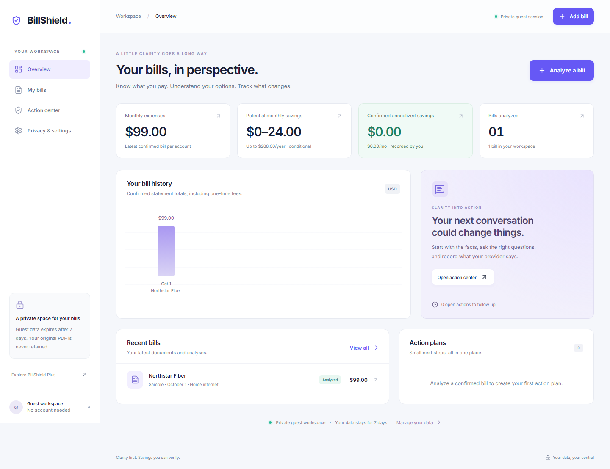

# BillShield

**Stop overpaying. Start saving.** A working guest-first application for understanding U.S. residential internet bills, preparing provider conversations and tracking user-confirmed reductions.

**Live application:** [billshield-tyxt.onrender.com](https://billshield-tyxt.onrender.com). Verified with the full guest PDF-to-outcome browser journey.

## Run locally

Use **Node.js 22 LTS (22.3 or later)** and npm. The original machine had Node 26 outside PATH; a portable Node 22 runtime was downloaded under ignored `.local/` for verification. Do not commit it.

```powershell
# On this machine, prefer the downloaded Node 22 runtime:
$env:Path = "$PWD\.local\node-v22.23.5-win-x64;C:\Program Files\nodejs;$env:Path"
npm ci
Copy-Item .env.example .env
npm run db:local
```

Keep PostgreSQL running; in a second terminal:

```powershell
# Apply the same PATH line above if Node is not on this terminal's PATH.
npm run db:migrate
npm run dev
```

Open **http://localhost:3000**. `npm run db:local` runs a real, persistent, loopback-only PostgreSQL cluster in `.local/postgres`, with development-only credentials from `.env.example`. Alternatively use your own PostgreSQL 16+ database and update `DATABASE_URL`. Do not run the embedded development database in production.

Do not overwrite an existing `.env` containing your own configuration. For a local production server (`npm run build` then `npm start`), first replace the placeholder rate-limit and cron secrets as described below. The Playwright-managed test server supplies a test-only rate-limit secret.

Start at `/demo`, upload a real PDF, review fields, confirm and analyze, create an action and record an outcome. `/bills/new` also offers labeled synthetic PDFs through the identical processing pipeline. To compare October and November samples, link the second bill to the first bill's service account. No data is seeded into application workspaces.

## What works

- Responsive marketing, demo, dashboard, bills, editable review, analysis, action center, pricing and privacy pages.
- Secure anonymous sessions, hashed tokens, database-backed isolation, seven-day expiration and deletion.
- Real text-based PDF parsing, signatures/MIME/size validation, ephemeral documents, manual fallback for scans.
- Exact integer-cent calculations, equipment/add-on/fee/promotion rules, same-account chronological bill comparison, explicit reconciliation.
- Evidence-backed recommendations, conditional savings ranges, personalized template scripts, provider responses and confirmed outcomes.
- Persistent dashboard, historical statements, action statuses and consolidated per-account savings.
- Optional structured OpenAI extraction with evidence validation, quotas, timeout and deterministic fallback. It is disabled by default and was not verified against a live provider.

## Architecture

Next.js 16 App Router + React + strict TypeScript, Lucide icons and a custom responsive CSS system. Route handlers delegate to modular application services, Prisma 6 and PostgreSQL. Zod validates inputs. Domain rules contain no database or AI dependencies. PDF parsing happens in a short-lived child process with a 192 MB V8 heap limit and 20-second timeout; native allocations are additionally constrained by production container limits. See [architecture](docs/ARCHITECTURE.md) and [API](docs/API.md).

## Product screenshots

Captured from the running production build using a labeled fictional PDF:



[Landing page](docs/screenshots/landing.png) · [Editable review](docs/screenshots/review.png) · [Analysis](docs/screenshots/analysis.png) · [Mobile dashboard](docs/screenshots/mobile.png)

## Commands

```text
npm run db:generate       Generate Prisma client
npm run db:migrate        Apply committed SQL migrations
npm run fixtures          Regenerate labeled synthetic PDFs
npm run typecheck         Strict TypeScript
npm run lint              ESLint
npm test                  Financial rules and real PDF extraction
npx playwright install chromium
npm run build             Production build
npm run test:e2e          Production browser and HTTP integration tests
npm start                Production server
npm run cleanup          Remove expired guest workspaces and rate-limit rows
```

Playwright starts a production server if one is not already running. PostgreSQL and applied migrations are required. Tests create isolated guests and delete their test records where practical. Fixtures are committed. Test results and gaps are recorded in [TEST_REPORT.md](docs/TEST_REPORT.md).

## Environment

| Variable            | Purpose                                                                                                               |
| ------------------- | --------------------------------------------------------------------------------------------------------------------- |
| `DATABASE_URL`      | Required PostgreSQL connection string; use TLS in production.                                                         |
| `APP_ORIGIN`        | Exact browser origin; required in production for CSRF validation.                                                     |
| `RATE_LIMIT_SECRET` | Random production secret for hashing anonymous rate-limit identifiers.                                                |
| `CRON_SECRET`       | Random bearer secret for scheduled cleanup endpoint.                                                                  |
| `OPENAI_API_KEY`    | Optional; enables structured extraction for up to five attempts per workspace.                                        |
| `OPENAI_MODEL`      | Optional model supporting strict structured output; default `gpt-4.1-mini`.                                           |
| `SENTRY_DSN`        | Optional sanitized operational error reporting. Not live-tested.                                                      |
| `TRUST_PROXY`       | Set `1` only when your reverse proxy overwrites `X-Forwarded-For`. Vercel uses its own overwritten forwarding header. |

`.env` is ignored. Generate production secrets with `node -e "console.log(require('crypto').randomBytes(32).toString('hex'))"`.

## Deployment and submission

Free hackathon deployment: **[Deploy to Render](https://render.com/deploy?repo=https://github.com/Eqziz/billshield)**. The included Blueprint declares a Free web service and Free PostgreSQL database, generates secrets and applies migrations automatically. The web service sleeps on inactivity; the free database expires after 30 days. See [the exact setup and limits](docs/RENDER.md). This link opens deployment setup; an actual hosted URL is not yet verified.

See [DEPLOYMENT.md](docs/DEPLOYMENT.md) for Docker/managed PostgreSQL and Vercel instructions, serverless upload caveats and release checks. Public source: [https://github.com/Eqziz/billshield](https://github.com/Eqziz/billshield), verified accessible without authentication. **Public application verified:** https://billshield-tyxt.onrender.com. The Render deployment uses managed PostgreSQL; free-plan lifetime and capacity limits still apply. The Node/Prisma/child-process application is not compatible with Sites Worker hosting without substantial runtime changes.

Presentation: [10-slide PDF](docs/BillShield-pitch.pdf), [standalone HTML deck](docs/BillShield-pitch.html), [overview](docs/BillShield-pitch-preview.png), and [English speaker notes](docs/PITCH.md). The deck includes actual hosted-product screenshots, QR codes and clickable links. Pricing/revenue examples remain labeled hypotheses. Run `npx playwright install chromium` once, then `npm run pitch` to regenerate the artifacts; `npm run pitch:capture` refreshes screenshots in a disposable synthetic guest workspace. Editable layouts are in `scripts/pitch/deck.ts` and `scripts/pitch/theme.css`.

## Security, privacy and limits

Original PDFs are not retained or served. Extracted financial fields and evidence, original filename, hash, byte count, minimal audit events and quota counters persist until deletion/expiry cleanup. Do not put account numbers in labels. Anonymous access requires the server-issued HttpOnly cookie. All object lookups enforce workspace ownership. State-changing browser requests require an exact Origin match. Rates and quotas persist in PostgreSQL.

This release has no OCR, provider integrations, automated negotiation, payments or long-term authenticated accounts. Pricing is a hypothesis. Confirmed savings are **user-attested**, not independently verified with a provider. Annualized amounts project twelve unchanged months; one-time credits are excluded. A bill increase is a comparison, not an assumed recoverable discount. Optional AI redaction is best effort; use manual entry to avoid sending document text to a provider.

Session creation opportunistically removes expired guests; production must also schedule cleanup. Seven days is the guest retention window, not a promise that an unscheduled deployment physically deletes records at the exact expiration second. Expired sessions immediately lose access. Metadata deletion is described in the API guide.
