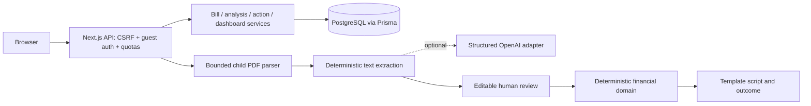

# Architecture

## Components and flow

The App Router renders marketing pages and client workspace screens. `/api/v1/[...path]` is the HTTP controller: it checks request origin, rate limits and guest authentication, validates requests and dispatches to services. No React component reads the database.

PDF content is accepted only as PDF MIME + extension + signature, capped at 10 MB. The parser accepts at most 20 pages, extracts at most 150,000 characters and runs with a 20-second timeout/192 MB JS heap. PDF scripts are never executed. No document URL is loaded; embedded images are not rendered. The process has no UI and is killed on timeout. Container memory limits are needed to cap native allocations and concurrent requests. Filenames are metadata, never filesystem paths.

Text extraction recognizes explicit statement totals, date labels, provider labels/common provider names and trailing dollar values. It is intentionally conservative and cannot reliably read every provider layout. Unknown totals and dates remain null. Uncertain charges are marked for review. Scans lead to manual entry, not invented OCR.

AI is an optional replaceable function adapter. Its strict JSON output is parsed with Zod; every charge must cite exact document evidence containing the same monetary amount. Failed, malformed or ungrounded output falls back. Calculations and scripts never depend on an LLM. Prompt injection cannot modify domain rules. Redaction is best effort and not a complete PII detector.

## Data relationships

User → Workspace (future accounts); Workspace → GuestSession, ServiceAccount, DocumentAsset, AuditEvent and ApiUsage. ServiceAccount → Bill and SavingsEvent. Bill → BillLineItem and versioned Analysis → Opportunity → ActionPlan → SavingsEvent. Guest tokens are stored only as SHA-256 hashes; random tokens carry 256 bits of entropy. Document assets contain metadata; raw PDF storage keys are null and deletion timestamps reflect immediate disposal.

Accounts are linked explicitly by the user, never by provider name alone. Each bill revision has at most one analysis. Editing increments the revision, returns the bill to draft and marks older analyses stale. Historic action outcomes remain accessible. Creating an action from stale analysis is refused. Editing confirmed facts does not silently re-approve the bill.

Serializable transactions protect bill updates, confirmation, analysis and action outcomes; conflicting requests receive HTTP 409 and may be retried. Analyses, actions and outcomes have uniqueness constraints. Repeated uploads with the same file hash in a workspace return the existing bill before parsing or AI. Simultaneous duplicates can return 409. Upload attempts are quota-limited even when invalid.

## Financial boundaries

All authoritative money values are signed integer cents. UI dollar strings are converted digit-by-digit. Only recurring, positively charged, verified-as-monthly equipment and apparent optional add-ons receive quantified potential ranges, starting at zero. Unknown recurrence is not annualized. Each item forms an overlap group; group maxima are consolidated and the sum is capped at the recurring bill cost. Existing promotions, retention questions and bill increases receive no speculative savings amount. One-time fees stay separate.

Comparisons require the same explicitly selected service account and a prior statement/service-period date. One-time amounts are removed; differences in service period lengths, usage or plan details are not normalized. The recommendation explicitly discloses those assumptions. A consumer should review partial-period bills before drawing conclusions.

Confirmed savings count only user-confirmed successful outcomes effective by today. For each account, the earliest effective confirmed previous price is the baseline and the latest effective new price is the current price. These are subtracted once per account to prevent duplicated actions from inflating savings. Annualized savings multiply this recurring reduction by 12 and are projections, not realized cash. Notes retain context; one-time credits cannot enter this path.

## Security and operations

Cookies: HttpOnly, SameSite=Lax, path=/, Secure in production. Mutations require exact `APP_ORIGIN`; object-level authorization is checked on every data path. No workspace IDs supplied by the client authorize access. Errors expose safe messages and request IDs; unexpected errors are logged/reported without financial content or request bodies.

Database rate limits use HMAC-hashed trusted proxy addresses and minute buckets. Without a trusted proxy, limits fall back to a single shared bucket, deliberately conservative. Workspace quotas: 30 bills, 60 upload attempts and five AI attempts over seven days. There is no distributed queue; processing finishes within each request. Hosted ingress must enforce request-body and concurrency limits.

Deployment: Node 22 container or Node serverless host + TLS PostgreSQL; no Redis or public file bucket. A scheduler invokes authenticated cleanup. No external infrastructure is provisioned in this checkout. Optional Sentry reports only generic failure events; live delivery is unverified.

Tradeoffs: conservative extraction needs human review; API routing is centralized while services/domain stay separated; custom CSS avoids unnecessary UI dependencies; no OCR/authentication/checkout until the core workflow is proven. Tests use real PostgreSQL and real PDFs, not hardcoded extraction branches.
